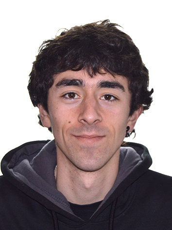

::: {.columns .v-center}

::: {.column width="35%"}

{width=50%}

[Email](mailto:ion.mikel.liberal@iiia.csic.es) ·
[ORCID](https://orcid.org/0009-0000-8160-4292) ·
[LinkedIn](https://www.linkedin.com/in/ion-mikel-liberal-gra%C3%B1a-2074301b2/)

:::

::: {.column width="65%"}
 

# About me {#aboutme}

I am a PhD student at the Artificial Intelligence Research Institute (IIIA-CSIC), where I study MaxSAT from both practical and theoretical perspectives. My advisors are Jordi Levy and Ilario Bonacina and our research focuses on the design of new algorithms within the SAT-based paradigm, as well as on understanding their strengths and limitations through the lens of proof complexity. Outside my main research area, I am deeply interested in pure logic and the foundations of mathematics.
:::

:::

---

---

---

# Publications {#publications}

## 2026

- "Beyond Core-Guided MaxSAT" [DOI](https://doi.org/10.4230/LIPIcs.SAT.2026.9) .

Joint work with Ilario Bonacina and Jordi Levy.

---

# Talks {#talks}

## "Beyond Core-Guided MaxSAT"
- CP/SAT Doctoral Program 2025, Glasgow.

View slides

 
<iframe
src="slides_Glasgow.pdf"
width="100%"
height="700px">
</iframe>
 

  

## "Cardinality Constraints are Hard for Resolution"
-  CP/SAT Doctoral Program 2026, Lisboa.
-  Proof Complexity Workshop 2026, Lisboa.

View slides

 
<iframe
src="slides_Lisboa.pdf"
width="100%"
height="700px">
</iframe>
 

---

